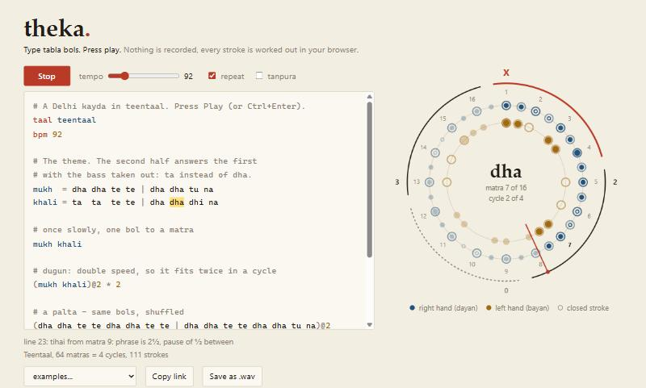

# theka

A small language for tabla. You type the bols, the browser plays them.



```
taal teentaal
bpm 92

mukh  = dha dha te te | dha dha tu na
khali = ta  ta  te te | dha dha dhi na

mukh khali
(mukh khali)@2 * 2
(mukh khali)@2
tihai((dha dha te te dha!)@2)
```

That is a complete piece: a theme, the theme at double speed, and a tihai that
lands on sam. Nowhere in it does anyone count the pause inside the tihai.
theka works that out.

There are no audio files in this repository. Every stroke is synthesised when
it is played. There are no dependencies either, and no build step.

## Running it

Open `index.html`. That's it, double-clicking the file works.

If you would rather have it on a local address:

```
node serve.js
```

and go to http://localhost:8377.

Press **Play** or Ctrl+Enter. You can keep typing while it plays. The link in
the address bar always contains the whole composition, so **Copy link** gives
you something you can send to someone.

## The language

| you write | you get |
|---|---|
| `dha dhin dhin dha` | one bol per matra |
| `-` | a rest |
| `dhage` `tirakita` | bols written together share one matra |
| `[dha - ge]` | anything inside is squeezed into one matra (nests) |
| `dha!` | an accent |
| `(dha ti ta)*3` | repeat |
| `(dha ti ta)@2` | double speed. `@3` is triple, and so on |
| `mukh = dha dha te te` | name a phrase. Afterwards `mukh` is a word like any other |
| `tihai(dha ti ta)` | the phrase three times, last stroke on sam |
| `taal rupak` | teentaal, keherwa, dadra, rupak, jhaptaal or ektaal |
| `bpm 120` | tempo in matras per minute |
| `sa c#` | what the dayan is tuned to (a note, or Hz) |
| `\|` | bar line. Ignored, it is there for the reader |
| `# ...` | comment |

Bols it knows:

| | |
|---|---|
| both hands | `dha` `dhin` `dhi` |
| right hand, ringing | `ta` `na` `tin` `tun` `tu` |
| right hand, closed | `te` `ti` `ra` |
| left hand, bass | `ge` `ghe` `ga` |
| left hand, slap | `ke` `ka` `ki` `kat` |

Mistakes get a message with the line number, and a guess where it can
manage one:

```
line 5: "dhinn" is not a bol or a phrase I know - did you mean "dhin"?
```

## How it works

Three parts turned out to be more interesting than expected.

### 1. The tihai solver

A tihai is a phrase played three times so that its final stroke falls exactly
on sam. Players work these out in their heads. Here it is one equation.

Say the phrase is `L` matras long, its last stroke sits `d` matras into it,
and there is a pause `g` between repetitions. The last stroke of the third
repetition then falls

    2 × (L + g) + d

matras after the tihai starts. That has to equal the distance to a sam.
If the next sam is `toSam` matras away and the taal has `N` matras:

    g = (toSam + k×N − d − 2L) / 2

for the smallest `k` (0, 1, 2 ...) that does not make `g` negative. `g = 0`
is what musicians call a *bedam* tihai, no breath between repetitions.

So the same `tihai(...)` line gives different results depending on where in
the cycle it starts. Try the "Tihai playground" example and add a bol to the
lead-in.

All positions are kept as exact fractions (`src/lang.js`, top of the file).
With floating point, a triplet inside a double-speed tihai ends at matra
15.999999999 and "is this on sam?" stops having a clean answer.

One detail: the last stroke of a tihai sits *on* the sam of the next cycle.
If another line follows, its first bol is on that same sam and takes over
the landing stroke. That is what happens in practice too, where the tihai's
last dha is the first dha of the theka.

### 2. The sound

An ordinary drum has no clear note because the overtones of a stretched
skin are not in tune with each other. The tabla is an exception. The black
patch in the middle (the syahi) adds weight exactly where it is needed to
pull the overtones into a near-harmonic series, 1 : 2 : 3 : 4 : 5.
C. V. Raman measured this in the 1920s and 30s.

That is good news for synthesis. The right-hand drum is five sine waves, and
the strokes are different mixes of them:

| stroke | what the hand does | what you hear |
|---|---|---|
| `tun` | open hand, whole skin moves | mostly the fundamental |
| `tin` | soft tap on the patch | fundamental and some 2nd |
| `na` | ring finger damps the middle | fundamental almost gone, 2nd and 3rd ring |
| `te` | flat fingers stay on the skin | no ring, a short filtered noise burst |

The left-hand drum is one low sine with its pitch pushed up and let go
again, which is the heel of the hand pressing into the skin.

Two details matter more than the exact numbers:

- A new stroke on a drum cuts off whatever was ringing on that drum. Every
  stroke goes through its own gain node so the next one can silence it.
- Harder hits are brighter and not only louder. Upper partials are scaled
  by a higher power of the velocity than the fundamental.

The tanpura drone is a wave with 26 harmonics through a lowpass filter that
opens a moment after each pluck. That late bloom is a rough imitation of what
the curved bridge does on the real instrument.

All of this is in `src/tabla.js`, about 200 lines.

### 3. Timing

`setTimeout` is not accurate enough to play music with. Nothing is played
"now". A timer wakes up every 25 ms and gives the Web Audio clock every
stroke due in the next 120 ms with an exact timestamp. The highlighted bol
and the hand on the wheel read the same clock, so they stay with the sound.

Editing while it plays swaps the program in at the current matra instead of
starting over.

## Files

```
index.html, style.css   the page
src/taals.js            the six taals
src/lang.js             lexer, parser, tihai solver    (no DOM, runs in node)
src/tabla.js            drum and tanpura synthesis
src/player.js           scheduler, WAV export
src/wheel.js            the cycle drawn on a canvas
src/app.js              editor, buttons, share links
src/examples.js         the examples menu
test/lang.test.js       tests for the language
```

## Tests

```
npm test
```

Needs Node 20 or newer and nothing else. The tests cover the language. The one
worth reading checks that a tihai lands on sam from every starting position,
in every taal, for a handful of awkward phrases: about 1,400 cases.

The audio has no automated tests. It was checked by rendering strokes offline
and looking at which partials came out.

## What it does not do

- It is an imitation. Side by side with a recording of a real tabla you
  will hear the difference, most of all on the bayan.
- Six taals. Adding one is five lines in `src/taals.js`.
- Plenty of bols are missing: `dhere dhere`, `kran`, `tit`, `dhet`.
- The `ta` at the end of `tirakita` is played as an open `na`. A player
  would keep it closed at speed.
- No laya changes within a piece other than `@`.

## Licence

MIT
